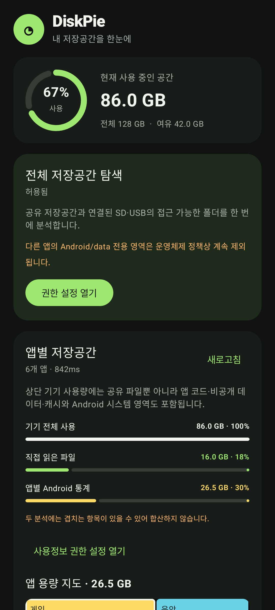
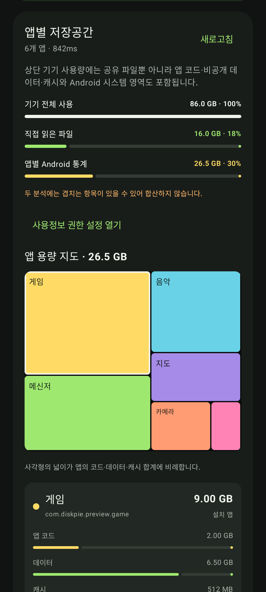
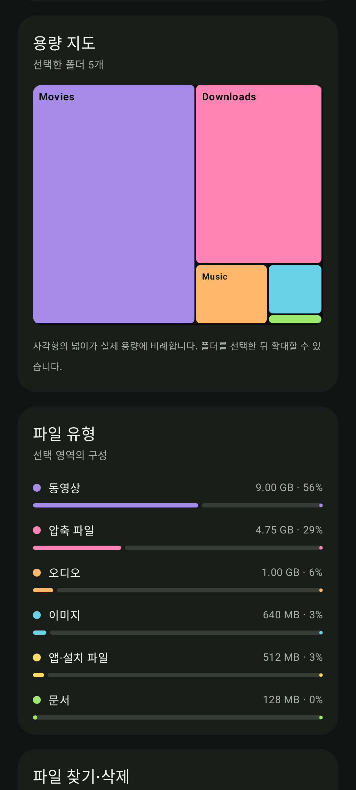

# DiskPie

DiskPie는 Android 저장공간을 WinDirStat처럼 빠르게 훑어보는 모바일 앱입니다. 기기의 전체 사용량을 보여주고, 사용자가 선택한 폴더의 실제 파일 크기와 설치 앱별 저장공간 통계를 각각 트리맵과 순위로 분석하며 확인한 개별 파일을 삭제할 수 있습니다.

## 화면 미리 보기

v0.4.0의 실제 Compose UI에 예시 데이터를 넣어 렌더링한 화면입니다. 표시된 용량·앱 이름·파일명·분석 시간은 시연용이며, 실제 사용자 기기를 스캔한 결과가 아닙니다. 이미지를 누르면 크게 볼 수 있습니다.

| 저장공간 요약 | 앱별 저장공간 | 파일 용량 지도 |
| --- | --- | --- |
| [](docs/images/storage-overview.png) | [](docs/images/app-storage.png) | [](docs/images/file-treemap.png) |
| 기기의 사용·여유 용량과 분석 범위 확인 | 설치 앱별 용량 지도와 세부 구성 확인 | 큰 폴더·파일과 유형별 사용량 탐색 |

[이미지 제작 조건](docs/images/README.md)

## APK 다운로드

**[GitHub Releases에서 최신 APK 다운로드](https://github.com/Uree1229/DiskPie/releases/latest)**

Releases 페이지의 **Assets**에서 `DiskPie-vX.Y.Z.apk`를 선택하세요. Android 8.0(API 26) 이상이 필요하며, Play 스토어 외부에서 설치하므로 기기에서 해당 브라우저나 파일 관리자의 **알 수 없는 앱 설치** 권한을 허용해야 할 수 있습니다.

현재 APK는 개발 프리뷰 빌드입니다. 설치 전에 같은 패키지의 다른 서명 버전이 있다면 Android가 기존 앱 제거를 요구할 수 있습니다.

## 현재 구현된 MVP

- 내부 저장공간의 전체/사용/여유 용량 요약
- Android 11 이상의 앱별 **모든 파일 접근** 동의 후 공유 저장공간·SD·USB 전체 스캔
- Android 시스템 폴더 선택기(Storage Access Framework)
- 여러 폴더의 누적 선택, 개별 체크, 전체 선택·해제 및 통합 재귀 스캔
- 용량 비례 squarified treemap 및 폴더 확대 탐색
- 별도 **사용정보 접근** 동의 후 설치 앱별 코드·데이터·캐시 용량 지도와 상위 앱 순위
- 기기 전체 사용량, 직접 읽은 파일, 앱별 Android 통계의 집계 범위 비교
- 이미지, 동영상, 오디오, 문서, 압축 파일, 설치 파일, 기타 분류
- 상위 20개 대용량 파일과 파일명 검색
- 연결 앱으로 파일 열기
- 파일명·용량을 재확인하는 삭제 확인창과 삭제 후 자동 재분석
- 분석 진행 상태, 취소, 재분석, 접근 불가 항목 안내
- 재부팅 후에도 유지되는 선택 폴더 읽기·쓰기 권한

전체 저장공간 분석은 앱 안의 사용 목적 안내에 동의한 뒤 Android 시스템 설정에서 **모든 파일 접근**을 별도로 허용한 경우에만 활성화됩니다. 앱별 저장공간 분석도 안내에 동의한 뒤 시스템 설정에서 **사용정보 접근**을 별도로 허용해야 합니다. 두 분석은 기기 안에서 수행되며, 앱은 인터넷 권한을 선언하지 않습니다. 권한을 허용하지 않아도 시스템 폴더 선택기로 고른 위치만 분석할 수 있습니다. 삭제는 분석 결과의 개별 파일에만 제공하며 폴더 전체 삭제는 지원하지 않습니다.

## 실행

요구 사항:

- Android Studio Quail 1 이상
- JDK 17 이상
- Android SDK 37

1. Android Studio에서 이 폴더를 엽니다.
2. Gradle Sync가 끝나면 Android 8.0(API 26) 이상의 기기 또는 에뮬레이터를 선택합니다.
3. `app` 구성을 실행합니다.
4. 공유 저장공간 전체를 분석하려면 **전체 접근 동의 및 설정**에서 안내에 동의한 뒤 Android 시스템 설정의 **모든 파일 접근**을 허용합니다.
5. 앱별 용량을 분석하려면 **앱 용량 분석 동의 및 설정**에서 안내에 동의한 뒤 Android 시스템 설정의 **사용정보 접근 허용**을 켭니다.
6. 제한된 범위만 분석하려면 **첫 폴더 선택** 또는 **폴더 추가**로 필요한 위치를 더한 뒤 개별 체크 또는 **전체 폴더 선택·해제**를 사용합니다.

이전 버전에서 이미 선택한 폴더는 읽기 권한만 저장되어 있을 수 있습니다. 삭제 버튼이 비활성화되어 있다면 **폴더 선택**에서 같은 폴더를 다시 허용하세요.

명령줄에서는 Android SDK 경로가 설정된 환경에서 다음을 실행할 수 있습니다.

```powershell
.\gradlew.bat test
.\gradlew.bat assembleDebug
```

## Android 저장소 제약

Android 11 이상에서는 시스템 폴더 선택기가 내부 저장소 최상위, 다운로드 최상위, `Android/data`, `Android/obb` 등을 허용하지 않습니다. DiskPie는 사용자가 **모든 파일 접근**을 승인하면 시스템 선택기 대신 직접 파일 경로로 공유 저장공간과 연결된 SD·USB를 분석합니다.

이 특별 접근 권한으로도 다른 앱의 `Android/data` 전용 디렉터리와 운영체제가 보호하는 일부 영역은 열 수 없습니다. 앱 내부 동의만으로 이 Android 보안 경계를 해제할 수는 없습니다. Google Play에 배포할 때는 이 고위험 권한의 사용 목적을 Play Console에 신고하고 승인을 받아야 합니다.

DiskPie는 이 차이를 보완하기 위해 Android의 `StorageStatsManager` 통계를 별도로 사용합니다. 사용정보 접근을 허용하면 설치된 앱의 코드, 데이터, 캐시 크기를 앱별로 표시하지만 파일 내용이나 앱 사용기록은 읽지 않습니다. 파일 스캔과 앱 통계에는 겹치는 항목이 있을 수 있으므로 두 수치는 합산하지 않으며, 운영체제·예약 공간 등은 앱별 통계에도 귀속되지 않을 수 있습니다. 설치 앱 전체 조회 권한도 Google Play 배포 시 핵심 기능 적합성 심사 대상입니다.

파일 삭제는 해당 문서 공급자가 삭제를 지원하고 쓰기 권한을 제공할 때만 동작합니다. 공급자에 따라 휴지통을 거치지 않고 즉시 삭제될 수 있으므로 확인창의 파일명과 용량을 반드시 확인해야 합니다.

## 코드 구조

```text
app/src/main/java/com/diskpie/app/
├── data/              # 기기·앱 용량 조회, SAF·직접 경로 재귀 스캐너, 파일 삭제
├── model/             # 파일 트리, 분류, 파일·앱 분석 결과
├── ui/                # Compose 대시보드
│   ├── theme/
│   └── treemap/       # 순수 Kotlin 트리맵 레이아웃 + UI
├── DiskPieViewModel.kt
└── MainActivity.kt
```

## 다음 단계 후보

- 최근 분석 결과 캐시 및 이전 스캔과 증감 비교
- 폴더별 정렬 가능한 상세 목록
- 중복 파일 후보 탐지(크기 → 부분 해시 → 전체 해시)
- 파일 다중 선택과 공유 작업
- SD 카드와 USB 저장장치별 요약
- 백그라운드 분석 알림과 대규모 트리 최적화
